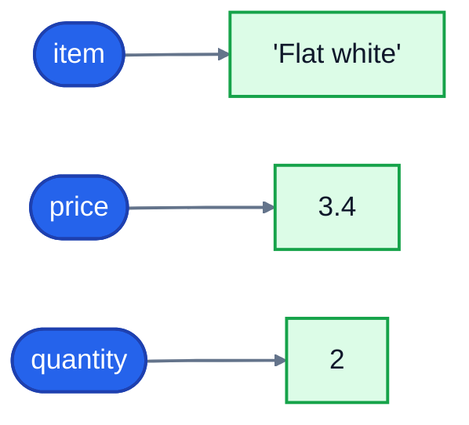

# 1. Variables

A program is mostly about working with values: prices, names, dates, scores. A **variable** is a name you give to a value so you can use it later.

## Your first variables

Imagine you're writing the till software for a small café. A customer orders two flat whites:

```python
item = "Flat white"
price = 3.40
quantity = 2
print(item, price, quantity)
```

```
Flat white 3.4 2
```

Each line with an `=` is an **assignment**. It means "store the value on the right under the name on the left". It doesn't mean "equals" the way it does in maths. Read `price = 3.40` as "price is now 3.40".

`print()` shows values on the screen. Give it several, separated by commas, and it prints them with spaces in between. Notice that `3.40` printed as `3.4`: Python stores the number, not the way you typed it. (Lesson 3 shows how to print money with two decimal places.)

## Variables picture

It helps to think of a variable as a **label stuck onto a value**, not as a box the value lives in:



When you assign a new value, Python moves the label to the new value. This picture explains some behaviour that otherwise looks strange, as you'll see below.

## Calculating with variables

Once a value has a name, you can use the name anywhere you'd use the value:

```python
price = 3.40
quantity = 2
total = price * quantity
print(total)
```

```
6.8
```

Python works out the right-hand side first (`3.40 * 2`), then stores the result under the name `total`. The common maths operators are `+`, `-`, `*` (multiply) and `/` (divide).

## Changing a variable

Variables can change. That's why they're called variables. The café starts the day with 20 croissants and sells two:

```python
stock = 20
stock = stock - 2
print(stock)
stock -= 5
print(stock)
```

```
18
13
```

`stock = stock - 2` looks odd if you read `=` as "equals". Read it as an instruction instead: "work out `stock - 2`, which is 18, then make `stock` refer to that". `stock -= 5` is a shorter way of writing `stock = stock - 5`. There's also `+=`, `*=` and `/=`.

## A variable holds a value, not a formula

After `total = price * quantity`, `total` is just the number `6.8`. If you change `price` afterwards, `total` doesn't update by itself. It was worked out once. If you want an up-to-date total, calculate it again.

The same idea, with two names:

```python
x = 10
y = x
x = 99
print(y)
```

```
10
```

`y = x` sticks the label `y` onto the value that `x` was on, which is `10`. Moving `x` to `99` afterwards doesn't move `y`.

## Naming variables

Good names make code readable. Compare `t = p * q` with `total = price * quantity`: the second explains itself.

The rules Python enforces:

- Names can contain letters, digits and underscores (`_`).
- They can't start with a digit. `2nd_item = "Croissant"` is an error:

  ```
  SyntaxError: invalid decimal literal
  ```

- They can't contain spaces or hyphens. `unit price` and `unit-price` don't work.
- Some words are reserved by Python and can't be used as names: `if`, `for`, `class`, `True`, `None` and a few others.

The conventions everyone follows:

- Use lowercase words separated by underscores: `unit_price`, `items_in_basket`. This style is called **snake_case**.
- Use names that say what the value **is**: `customer_name`, not `x` or `data2`.
- Write values that never change in capitals, like `VAT_RATE = 0.2`. Python doesn't stop you changing them, but the capitals tell other programmers not to.

**Names are case-sensitive.** `Price` and `price` are two different variables:

```python
Price = 5
price = 3
print(Price, price)
```

```
5 3
```

That's a common source of bugs, so stick to lowercase.

## Using a name before it exists

If you use a name you haven't assigned yet, or misspell one, Python stops with an error:

```
Traceback (most recent call last):
  File "receipt.py", line 1, in <module>
    print(total)
          ^^^^^
NameError: name 'total' is not defined
```

This is a **traceback**. Read it from the bottom: the last line names the problem (`NameError`) and the lines above show where it happened (line 1 of `receipt.py`). You'll see plenty of these, and every one tells you exactly where to look.

## Two small tricks

You can assign several variables in one line:

```python
first, second = "Tea", "Coffee"
print(first, second)
```

```
Tea Coffee
```

And a `#` starts a **comment**: Python ignores everything after it on the line. Use comments to explain *why* the code does something, when that isn't obvious from the code itself:

```python
VAT_RATE = 0.2   # UK standard rate
```

## Exercise: a receipt

Open [exercise.py](./exercise.py). It has a list of variables to fill in for a café receipt. Each one is set to `None` for now, which means "no value yet". Replace each `None` with the right value or calculation:

| Variable | What it should be |
|---|---|
| `product_name` | the text `"Blueberry muffin"` |
| `unit_price` | `2.75` |
| `quantity` | `4` |
| `subtotal` | `unit_price` times `quantity`, calculated, not typed in |
| `discount_percent` | `10` |
| `discount` | `subtotal` times `discount_percent`, divided by 100 |
| `total` | `subtotal` minus `discount` |

Then run the tests:

```bash
cd 01-variables
python3 -m unittest -v
```

Run the file itself too, to see what it prints:

```bash
python3 exercise.py
```

<details>
<summary>Hint</summary>

Calculations use the names of other variables, not the numbers: `subtotal = unit_price * quantity`. If you type `subtotal = 11.0`, it happens to be right today, but it's wrong as soon as the price changes. One of the tests checks for exactly that.

</details>

The full answer is in [solutions/01-variables.py](../solutions/01-variables.py).

## Recap

- `name = value` stores a value under a name. Read `=` as "is now", not "equals".
- Variables can change: `stock = stock - 2`, or `stock -= 2`.
- A variable holds a value, not a formula. It won't update by itself.
- Use clear snake_case names. Names are case-sensitive.
- A `NameError` means you used a name that doesn't exist yet, often because of a typo.

Next: [2. Data types](../02-data-types/)
