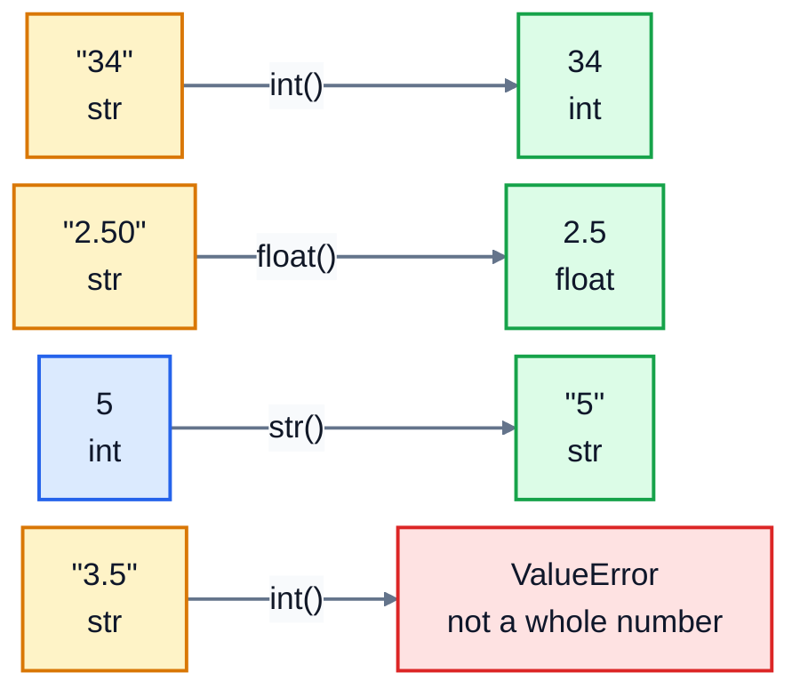

# 2. Data types

Every value in Python has a **type**, and the type decides what you can do with it. You can multiply two numbers, but you can't multiply two names. You can make text uppercase, but not a number. Most beginner errors come down to having the wrong type, so this lesson is worth taking slowly.

## The five types you'll use most

| Type | What it holds | Examples |
|---|---|---|
| `int` | whole numbers | `42`, `-7`, `0` |
| `float` | numbers with a decimal point | `3.5`, `0.2`, `-1.0` |
| `str` | text (a "string" of characters) | `"latte"`, `'Alex'`, `""` |
| `bool` | true or false | `True`, `False` |
| `NoneType` | "no value" | `None` |

`type()` tells you the type of any value:

```python
print(type(42), type(3.5), type("latte"), type(True), type(None))
```

```
<class 'int'> <class 'float'> <class 'str'> <class 'bool'> <class 'NoneType'>
```

## Numbers: int and float

Python has two kinds of number. Whole numbers are `int`; numbers with a decimal point are `float`. You can mix them in calculations.

```python
print(7 / 2, 7 // 2, 7 % 2, 2 ** 3)
print(6 / 2)
```

```
3.5 3 1 8
3.0
```

| Operator | Meaning | Example | Result |
|---|---|---|---|
| `+` `-` `*` | add, subtract, multiply | `4 * 3` | `12` |
| `/` | divide (always gives a float) | `6 / 2` | `3.0` |
| `//` | divide and round down to a whole number | `7 // 2` | `3` |
| `%` | remainder after dividing | `7 % 2` | `1` |
| `**` | power | `2 ** 3` | `8` |

`//` and `%` are more useful than they look. `minutes // 60` gives whole hours and `minutes % 60` the minutes left over. `n % 2` is `0` for even numbers and `1` for odd ones.

### Floats are close, not exact

```python
print(0.1 + 0.2)
print(round(0.1 + 0.2, 2))
```

```
0.30000000000000004
0.3
```

This isn't a Python bug. Computers store decimals in binary, and some decimals, like 0.1, can't be stored exactly, just as 1/3 can't be written exactly in decimal. The error is tiny, but it shows up when you print. Use `round(value, 2)` when you display money or measurements. (Programs that handle real money often use whole pennies or cents as integers, or Python's `decimal` module, to avoid this completely.)

## Text: str

A string is text between quotes. Single and double quotes both work: `'latte'` and `"latte"` are the same. Use double quotes when the text contains an apostrophe: `"Rosie's Café"`.

```python
name = "oat latte"
print(name.upper(), name.title(), len(name))
print("Order: " + name)
print("-" * 20)
```

```
OAT LATTE Oat Latte 9
Order: oat latte
--------------------
```

`+` joins strings together, and `*` repeats them. `len()` counts the characters, spaces included.

Strings come with **methods**: actions you run with a dot after the value. A few you'll use constantly:

```python
raw = "  Alex Kim  "
print("[" + raw.strip() + "]")
print("Kim" in raw, "kim" in raw)
print("a.b@Example.COM".lower())
print("2026-03-01".replace("-", "/"))
```

```
[Alex Kim]
True False
a.b@example.com
2026/03/01
```

| Method | What it does |
|---|---|
| `.strip()` | removes spaces (and newlines) from both ends |
| `.lower()`, `.upper()`, `.title()` | change the case |
| `.replace(old, new)` | swap one bit of text for another |
| `x in text` | `True` if `x` appears anywhere in `text` (case-sensitive) |

Methods don't change the original string. They give you back a new one. `raw.strip()` leaves `raw` exactly as it was, so if you want to keep the result, store it: `raw = raw.strip()`.

You can pick out characters by position, counting from 0:

```python
word = "coffee"
print(word[0], word[-1], word[0:3])
```

```
c e cof
```

`word[0]` is the first character and `word[-1]` the last. `word[0:3]` is a **slice**: characters 0, 1 and 2, stopping just before 3. Lesson 7 covers slices properly.

## True and False: bool

A `bool` is either `True` or `False`, with capital letters. You usually get one by comparing things:

```python
is_open = True
print(is_open, 3 > 2, 10 == 10.0, "a" == "A")
```

```
True True True False
```

`==` asks "are these equal?" It's two equals signs, because one `=` already means "store". The other comparisons are `!=` (not equal), `<`, `>`, `<=` and `>=`. Lesson 4 is all about using them.

## None: no value

`None` means "nothing here yet", like an empty field on a form:

```python
phone = None
print(phone, phone is None)
```

```
None True
```

Check for it with `is None`.

## Converting between types

Data often arrives as text. Anything the user types, anything read from a file, anything from a web form is a string, even when it looks like a number. Convert it before you calculate:

```python
print(int("34") + 1, float("2.50") * 2, str(5) + " items")
print(int(3.99), round(3.99))
```

```
35 5.0 5 items
3 4
```

| Function | Turns this | Into this |
|---|---|---|
| `int(x)` | `"34"` or `3.99` | `34` or `3` (it cuts off the decimals, it doesn't round) |
| `float(x)` | `"2.50"` | `2.5` |
| `str(x)` | `5` | `"5"` |
| `round(x, n)` | `3.14159, 2` | `3.14` |

If the text isn't a valid number, the conversion fails:

```
ValueError: invalid literal for int() with base 10: '3.5'
```

`int()` only accepts whole numbers written as text. For `"3.5"`, use `float()`, or `int(float("3.5"))` if you really want a whole number.

The same conversions as a picture. Text that holds a number becomes a real number, a number becomes text, and text that isn't a whole number can't become an `int`:



## The most common type mistake

```python
print("Total: " + 5)
```

```
TypeError: can only concatenate str (not "int") to str
```

You can't join text and a number with `+`, because Python doesn't guess what you mean. Convert the number first: `"Total: " + str(5)`. (Lesson 3 shows a neater way with f-strings.)

The reverse surprise is quieter, which makes it worse. It doesn't crash:

```python
print("5" + "5", "5" * 3)
```

```
55 555
```

If numbers seem to be "added" by sticking them together, they're strings. Convert them with `int()` or `float()`.

## Exercise: clean up a sign-up form

A café's loyalty scheme collects details through a web form. Everything arrives as text, often messy. Open [exercise.py](./exercise.py). It starts with the raw values, then a list of variables to fill in:

| Variable | What it should be |
|---|---|
| `age` | `age_text` converted to an `int` |
| `height_m` | `height_text` converted to a `float` |
| `is_member` | `True` if `member_text` is exactly `"yes"`, otherwise `False`, using a comparison, not by typing `True` |
| `clean_name` | `raw_name` with the spaces removed from both ends and each word capitalised: `"Alex Kim"` |
| `clean_email` | `raw_email` with the spaces removed and all lowercase |
| `age_next_year` | `age` plus 1 |
| `welcome` | the text `"Welcome, "` + `clean_name` + `"!"` |

Run the tests from the lesson folder:

```bash
cd 02-data-types
python3 -m unittest -v
```

<details>
<summary>Hint</summary>

You can chain string methods: `raw_name.strip().title()` strips first, then capitalises the result. A comparison gives a bool on its own, so `is_member = member_text == "yes"` stores `True` or `False`.

</details>

The full answer is in [solutions/02-data-types.py](../solutions/02-data-types.py).

## Recap

- `int` and `float` are numbers, `str` is text, `bool` is `True`/`False`, and `None` means no value.
- `/` always gives a float; `//` rounds down; `%` gives the remainder.
- Floats are approximate. Round them when you display them.
- String methods like `.strip()` and `.lower()` return a new string.
- Input from users and files is text. Convert it with `int()` or `float()` before doing maths.
- `TypeError` usually means two types got mixed up. Check them with `type()`.

Next: [3. Input and output](../03-input-and-output/)
