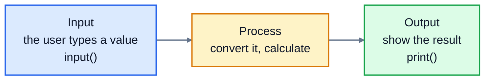

# 3. Input and output

Almost every program follows the same shape: take some input, do something with it, and show the result.



This lesson covers both ends: printing output that looks right, and reading what the user types.

## Printing

You've already used `print()`. It takes any number of values and prints them separated by spaces, then moves to a new line. Two optional settings change that:

```python
print("Latte", "Scone", "Juice")
print("Latte", "Scone", "Juice", sep=", ")
print("Loading", end="...")
print("done")
```

```
Latte Scone Juice
Latte, Scone, Juice
Loading...done
```

`sep` is what goes between the values (normally a space). `end` is what goes at the end (normally a new line).

Inside a string, `\n` starts a new line and `\t` inserts a tab:

```python
print("Line one\nLine two")
print("Name:\tAlex")
```

```
Line one
Line two
Name:	Alex
```

## f-strings: putting values into text

Joining text and numbers with `+` gets messy fast, because every number needs `str()`. **f-strings** are the modern way. Put an `f` before the opening quote, then write any variable or calculation inside curly braces:

```python
item = "Latte"
price = 3.4
print(f"{item} costs ${price}")
print(f"Two of them cost ${price * 2}")
```

```
Latte costs $3.4
Two of them cost $6.8
```

Python works out what's in the braces and puts the result into the text. No conversion needed.

### Formatting numbers

After a colon inside the braces, you can say *how* to show the value. This is how you print money properly:

```python
price = 3.4
print(f"${price:.2f}")
print(f"{1234567.891:,.2f}")
print(f"{0.175:.1%}")
```

```
$3.40
1,234,567.89
17.5%
```

| Format | Means | `3.4` becomes |
|---|---|---|
| `:.2f` | exactly 2 decimal places | `3.40` |
| `:,.2f` | thousands separators and 2 decimals | `3.40` (and `1234567.891` becomes `1,234,567.89`) |
| `:.0f` | no decimal places, rounded | `3` |
| `:.1%` | as a percentage, 1 decimal place | `340.0%` |
| `:>8` | right-aligned in 8 characters | `     3.4` |
| `:<8` | left-aligned in 8 characters | `3.4     ` |

Alignment is how you print tidy columns, like a receipt:

```python
print(f"{'Latte':<18}{3.4:>6.2f}")
print(f"{'Blueberry muffin':<18}{2.75:>6.2f}")
print(f"{'Tea':<18}{2.1:>6.2f}")
```

```
Latte               3.40
Blueberry muffin    2.75
Tea                 2.10
```

`:<18` pads the name to 18 characters, and `:>6.2f` right-aligns the price in 6 characters with 2 decimals, so the decimal points line up.

## Reading input

`input()` shows a prompt, waits for the user to type something and press Enter, and gives you what they typed:

```python
name = input("What's your name? ")
print(f"Hello, {name}!")
```

Running it looks like this, where `Alex` is what the user typed:

```
What's your name? Alex
Hello, Alex!
```

End the prompt with a space, so the user's typing doesn't run into your question.

### input() always gives you text

This is the most important thing in this lesson. Even if the user types a number, `input()` returns a string:

```python
cups = input("How many cups? ")
print(cups * 2)
```

```
How many cups? 3
33
```

`"3" * 2` is `"33"`: the text repeated twice. Convert the input as soon as you read it:

```python
cups = int(input("How many cups? "))
print(cups * 2)
```

```
How many cups? 3
6
```

`int(input(...))` reads the text, then converts it. Use `float(input(...))` for amounts like prices that can have decimals.

If the user types something that isn't a number, the conversion fails:

```
How many cups? three
Traceback (most recent call last):
  File "order.py", line 1, in <module>
    cups = int(input("How many cups? "))
ValueError: invalid literal for int() with base 10: 'three'
```

For now, that's fine. Lesson 9 shows how to catch the error and ask again instead of crashing.

## Exercise: split the bill

Write a program that helps a group split a restaurant bill. Open [exercise.py](./exercise.py) and write a program that:

1. Asks for the bill amount with the prompt `Bill amount: `
2. Asks for the tip percentage with the prompt `Tip percent: `
3. Asks how many people are paying with the prompt `Number of people: `
4. Prints four lines, with every amount to 2 decimal places:

```
Bill: $84.40
Tip (15%): $12.66
Total: $97.06
Each person pays: $24.27
```

The tip is the bill times the percentage divided by 100. The total is the bill plus the tip. Each person pays the total divided by the number of people. Here's the whole thing, with what the user typed:

```
Bill amount: 84.40
Tip percent: 15
Number of people: 4
Bill: $84.40
Tip (15%): $12.66
Total: $97.06
Each person pays: $24.27
```

The tests run your program several times with different answers, exactly as a user would, and check what it prints. Run them from the lesson folder:

```bash
cd 03-input-and-output
python3 -m unittest -v
```

You can also run your program yourself and type the answers in:

```bash
python3 exercise.py
```

<details>
<summary>Hint</summary>

Read the bill with `float(input(...))`, but the number of people and the tip percentage with `int(input(...))`, because they're whole numbers. In the tip line, the percentage is shown without decimals: `f"Tip ({tip_percent}%): ${tip:.2f}"`.

</details>

The full answer is in [solutions/03-input-and-output.py](../solutions/03-input-and-output.py).

## Recap

- `print()` takes `sep` and `end` to control what goes between values and at the end.
- f-strings, `f"...{value}..."`, put values into text without `str()`.
- `:.2f` shows two decimal places, `:,` adds thousands separators, `:<10` and `:>10` align.
- `input("prompt ")` always returns a string. Convert it with `int()` or `float()` straight away.

Next: [4. Conditionals](../04-conditionals/)
