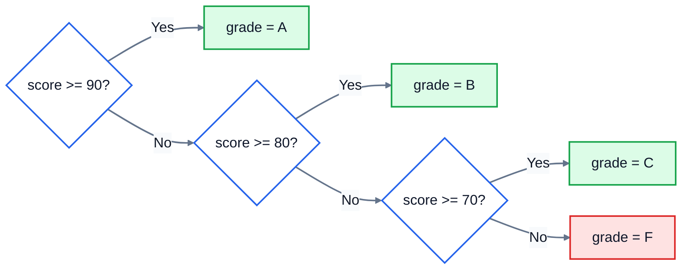

# 4. Conditionals

So far your programs run every line, top to bottom, every time. Real programs make decisions: free delivery if the order is big enough, a warning if the password is too short, a different price at weekends. That's what `if` is for.

## if

```python
temperature = 31
if temperature > 30:
    print("Hot day: put iced drinks on the board")
print("Board updated")
```

```
Hot day: put iced drinks on the board
Board updated
```

The line after `if` is a **condition**: something that's either `True` or `False`. If it's `True`, Python runs the indented lines below it. If it's `False`, it skips them. Either way, it carries on with the next line that isn't indented.

Two details matter, and Python insists on both:

- The `if` line ends with a **colon** (`:`).
- The lines that belong to the `if` are **indented**, by 4 spaces. The indentation is how Python knows where the `if` block ends. Your editor normally does this for you when you press Enter after a colon.

## if and else

`else` gives you the other path, for when the condition is `False`:

```python
total = 42.0
if total >= 50:
    print("Free delivery")
else:
    print("Delivery costs $4.99")
```

```
Delivery costs $4.99
```

Exactly one of the two blocks runs, never both.

## elif: more than two choices

For several possibilities, add `elif` ("else if") branches between them:

```python
score = 72
if score >= 90:
    grade = "A"
elif score >= 80:
    grade = "B"
elif score >= 70:
    grade = "C"
else:
    grade = "F"
print(grade)
```

```
C
```

Python checks the conditions **in order** and runs the first one that's `True`. Then it skips the rest. The `else` at the end catches everything that didn't match. Here's that decision as a picture:



Because the first match wins, **the order of the branches matters**. Put the strictest condition first. Swap them, and 95 gets a C:

```python
score = 95
if score >= 70:
    grade = "C"
elif score >= 90:
    grade = "A"
print(grade)
```

```
C
```

`95 >= 70` is true, so Python takes the first branch and never looks at the `>= 90` one.

## Comparisons

| Operator | Means |
|---|---|
| `==` | equal to |
| `!=` | not equal to |
| `<`, `>` | less than, greater than |
| `<=`, `>=` | less than or equal to, greater than or equal to |
| `in` | is in (a string, or a list of options) |

`in` is a tidy way to check against several options:

```python
day = "Saturday"
if day in ("Saturday", "Sunday"):
    print("Weekend opening hours")
```

```
Weekend opening hours
```

Text comparisons are exact: `"yes" == "Yes"` is `False`. When you compare something a user typed, tidy it first, for example `answer.strip().lower() == "yes"`.

## Combining conditions: and, or, not

```python
age = 17
has_permission = True
if age >= 18 or has_permission:
    print("Can join the trip")
if age >= 13 and age <= 19:
    print("Teenager")
if not has_permission:
    print("Ask a parent first")
```

```
Can join the trip
Teenager
```

- `and` is `True` only if **both** sides are true.
- `or` is `True` if **at least one** side is true.
- `not` flips `True` and `False`.

Python also lets you chain comparisons the way you'd write them in maths. `13 <= age <= 19` means the same as `age >= 13 and age <= 19`.

## Truthy and falsy values

`if` doesn't only work with `True` and `False`. Empty things count as false: `0`, `""` (empty text), `[]` (an empty list) and `None`. Almost everything else counts as true.

```python
basket = []
if basket:
    print("Ready to check out")
else:
    print("Your basket is empty")
```

```
Your basket is empty
```

`if basket:` reads naturally as "if there's anything in the basket".

## Common mistakes

**One equals sign instead of two.** `=` stores a value; `==` compares. Python catches this one for you:

```
    if x = 3:
       ^^^^^
SyntaxError: invalid syntax. Maybe you meant '==' or ':=' instead of '='?
```

**The missing colon:**

```
SyntaxError: expected ':'
```

**Forgetting to indent:**

```
IndentationError: expected an indented block after 'if' statement on line 2
```

**`or` with a bare value.** This looks reasonable but is always true:

```python
x = 5
if x == 1 or 2:
    print("This always prints")
```

```
This always prints
```

Python reads it as `(x == 1) or (2)`, and `2` on its own counts as true. Write both comparisons in full, `x == 1 or x == 2`, or use `x in (1, 2)`.

## Exercise: shipping calculator

An online shop charges for shipping like this:

| Order | Shipping |
|---|---|
| To the US, $50 or more | free |
| To the US, under $50 | $4.99 |
| Anywhere else, $100 or more | $9.99 |
| Anywhere else, under $100 | $19.99 |

Write a program in [exercise.py](./exercise.py) that:

1. Asks for the order total with the prompt `Order total: `
2. Asks for the country with the prompt `Country: `. Accept it in any case and with stray spaces: `us`, `US` and `  Us ` all mean the US.
3. If the order total is zero or less, prints `Order total must be more than zero` and nothing else.
4. Otherwise prints the shipping, as `Shipping: FREE` or `Shipping: $4.99`, then `Total to pay: $54.99` (the order total plus shipping, 2 decimal places).

For example:

```
Order total: 42.50
Country: us
Shipping: $4.99
Total to pay: $47.49
```

Run the tests from the lesson folder:

```bash
cd 04-conditionals
python3 -m unittest -v
```

<details>
<summary>Hint</summary>

Tidy the country first: `country = input("Country: ").strip().upper()`. Then work out the shipping cost as a number with `if`/`elif`/`else`, where free shipping is `0`. Print `FREE` when it's `0`, and `$` plus the amount otherwise. Check for an invalid total before anything else.

</details>

The full answer is in [solutions/04-conditionals.py](../solutions/04-conditionals.py).

## Recap

- `if condition:` runs the indented block only when the condition is true. Don't forget the colon and the indentation.
- `elif` adds more choices, and `else` catches the rest. The first true branch wins, so order matters.
- Compare with `==`, `!=`, `<`, `>`, `<=`, `>=` and `in`. Combine with `and`, `or` and `not`.
- Empty values (`0`, `""`, `[]`, `None`) count as false.

Next: [5. Loops](../05-loops/)
