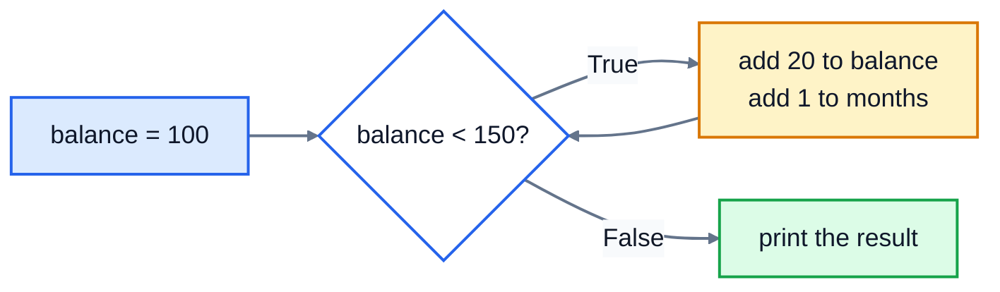

# 5. Loops

Computers are good at doing the same thing many times without getting bored or making mistakes. A **loop** runs a block of code repeatedly. Python has two kinds: `for` loops, which go through a collection of things, and `while` loops, which keep going as long as a condition is true.

## for: once for each item

```python
for drink in ["Latte", "Tea", "Mocha"]:
    print("Today we have:", drink)
print("That's the menu")
```

```
Today we have: Latte
Today we have: Tea
Today we have: Mocha
That's the menu
```

The square brackets make a **list**, a collection of values (lesson 7 covers lists in detail). The `for` line takes each item in turn, calls it `drink`, and runs the indented block once for it. When the items run out, the loop ends and Python carries on with the next unindented line.

`drink` is an ordinary variable that you name. Choose a name that describes one item: `for price in prices`, `for name in names`.

A `for` loop works on anything that's a sequence of things, including a string, one character at a time:

```python
for letter in "tea":
    print(letter)
```

```
t
e
a
```

## range: counting

To repeat something a set number of times, or to count, use `range()`:

```python
print(list(range(5)))
print(list(range(1, 6)))
print(list(range(0, 20, 5)))
```

```
[0, 1, 2, 3, 4]
[1, 2, 3, 4, 5]
[0, 5, 10, 15]
```

| Call | Gives |
|---|---|
| `range(5)` | 0, 1, 2, 3, 4: five numbers, **starting at 0** |
| `range(1, 6)` | 1 to 5: it stops **before** the end number |
| `range(0, 20, 5)` | counts in steps of 5 |

(`list()` is only there to show the numbers. In a loop, you use `range` directly.)

```python
for table in range(1, 4):
    print(f"Table {table} is ready")
```

```
Table 1 is ready
Table 2 is ready
Table 3 is ready
```

The end number is never included. To count from 1 to `n`, write `range(1, n + 1)`. Forgetting the `+ 1` is called an **off-by-one error**, and it's one of the most common bugs there is.

## Building up a result

A very common pattern is to start with an empty result, then add to it on each pass of the loop. Here's a running total for an order:

```python
prices = [3.40, 2.75, 2.10, 4.20]
total = 0
for price in prices:
    total = total + price
print(f"Total: ${total:.2f}")
```

```
Total: $12.45
```

Counting works the same way, combined with an `if`:

```python
prices = [3.40, 2.75, 2.10, 4.20]
count = 0
for price in prices:
    if price > 3:
        count += 1
print(count, "items cost more than $3")
```

```
2 items cost more than $3
```

The pattern is always the same: set the starting value **before** the loop, update it **inside** the loop, and use it **after** the loop.

To get a running number alongside each item, use `enumerate`:

```python
for number, drink in enumerate(["Latte", "Tea", "Mocha"], start=1):
    print(number, drink)
```

```
1 Latte
2 Tea
3 Mocha
```

## while: as long as something is true

A `while` loop keeps going as long as its condition is `True`. Use it when you don't know in advance how many times you'll need to repeat:

```python
balance = 100
months = 0
while balance < 150:
    balance = balance + 20
    months = months + 1
print(months, "months, balance", balance)
```

```
3 months, balance 160
```



Each time round, Python checks the condition first. If it's true, the body runs, then it checks again. As soon as the condition is false, the loop ends.

`while` is the natural choice for asking the user until they give a valid answer:

```python
password = ""
while password != "open-sesame":
    password = input("Password: ")
print("Welcome in")
```

```
Password: hello
Password: secret
Password: open-sesame
Welcome in
```

### Loops that never end

Something inside a `while` loop must eventually make its condition false. If nothing does, the loop runs forever. Here, `count` never changes:

```python
count = 0
while count < 5:
    print("Still going")
```

If your program seems stuck printing the same thing, press **Ctrl+C** to stop it, then look for the variable you forgot to update.

## break and continue

`break` ends a loop immediately. `continue` skips the rest of this pass and moves on to the next item:

```python
orders = ["Latte", "Tea", "STOP", "Mocha"]
for order in orders:
    if order == "STOP":
        break
    print("Making", order)
```

```
Making Latte
Making Tea
```

```python
for order in ["Latte", "", "Tea"]:
    if order == "":
        continue
    print("Making", order)
```

```
Making Latte
Making Tea
```

## Loops inside loops

A loop can contain another loop. The inner loop runs completely for each pass of the outer one. Here's a small multiplication table:

```python
for row in range(1, 4):
    line = ""
    for col in range(1, 4):
        line += f"{row * col:4}"
    print(line)
```

```
   1   2   3
   2   4   6
   3   6   9
```

## Common mistakes

- **Off by one:** `range(1, 10)` stops at 9. Use `range(1, n + 1)` to include `n`.
- **Resetting inside the loop:** if `total = 0` is indented inside the loop, it's wiped on every pass and you end up with only the last item.
- **Printing inside the loop:** if `print(total)` is indented inside the loop, it prints after every item. Outdent it to print once at the end.
- **A `while` loop that never stops:** make sure something inside it changes the condition.

## Exercise: savings goal

Write a program in [exercise.py](./exercise.py) that works out how long it takes to save up for something:

1. Ask how much is saved each month, with the prompt `Monthly saving: `
2. Ask for the goal, with the prompt `Savings goal: `
3. If the monthly saving is zero or less, print `Monthly saving must be more than zero` and stop. (Otherwise the loop would never end.)
4. Otherwise, starting from $0, add the monthly saving once per month. After each month, print the month number and the balance so far, like `Month 1: $250.00`. Stop as soon as the balance reaches the goal or goes past it.
5. Finally print `Goal reached in 4 months` (or `1 month` if it only takes one).

For example:

```
Monthly saving: 250
Savings goal: 900
Month 1: $250.00
Month 2: $500.00
Month 3: $750.00
Month 4: $1,000.00
Goal reached in 4 months
```

Use the `:,.2f` format for the balance so thousands get a comma. Run the tests from the lesson folder:

```bash
cd 05-loops
python3 -m unittest -v
```

<details>
<summary>Hint</summary>

You don't know how many months it'll take, so use `while balance < goal:`. Inside the loop, add the saving, add 1 to the month counter, and print the line. For the last message, use an `if` to choose between `month` and `months`.

</details>

The full answer is in [solutions/05-loops.py](../solutions/05-loops.py).

## Recap

- `for item in collection:` runs the block once per item.
- `range(start, stop)` counts from `start` up to, but not including, `stop`.
- Build results by setting a starting value before the loop and updating it inside.
- `while condition:` repeats as long as the condition is true. Make sure it eventually becomes false.
- `break` leaves the loop; `continue` skips to the next pass.

Next: [6. Functions](../06-functions/)
