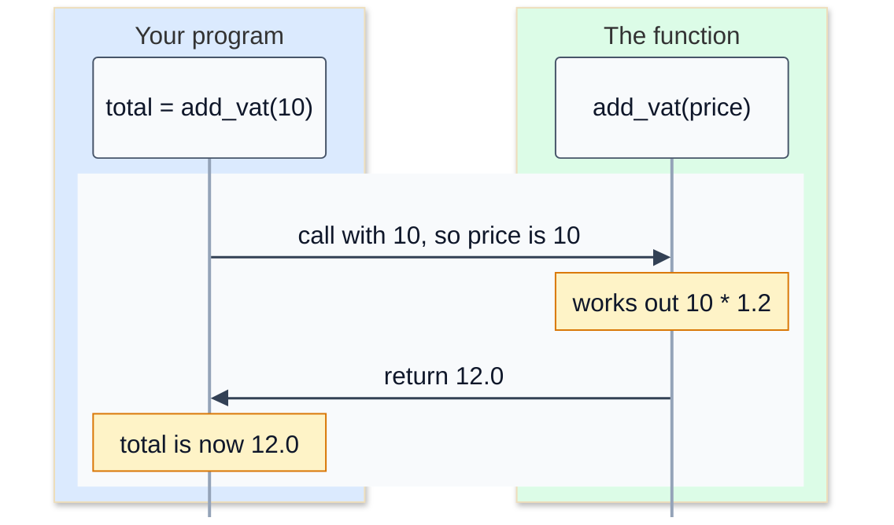

# 6. Functions

As programs grow, you find yourself writing the same few lines in several places: adding tax to a price, formatting money, checking a password. A **function** gives a name to a piece of code so you can run it whenever you need it, just by using its name.

You've been using functions since lesson 1: `print()`, `input()`, `len()` and `round()` are all functions that come with Python. Now you'll write your own.

## Defining and calling a function

```python
def greet(name):
    print(f"Hello, {name}! Your order is being prepared.")

greet("Alex")
greet("Sam")
```

```
Hello, Alex! Your order is being prepared.
Hello, Sam! Your order is being prepared.
```

- `def` starts a function **definition**. Then comes the function's name, brackets with its **parameters**, and a colon.
- The indented lines are the function's **body**: what it does.
- Defining a function doesn't run it. It runs each time you **call** it, by writing its name and brackets: `greet("Alex")`.
- The value you pass in, `"Alex"`, is an **argument**. Inside the function it's available under the parameter's name, `name`.

## return: handing back an answer

Most useful functions calculate something and **return** it to whoever called them:

```python
def add_vat(price):
    return price * 1.2

total = add_vat(10)
print(total)
print(add_vat(2.5) + add_vat(5))
```

```
12.0
9.0
```

`return` ends the function and sends the value back. The call `add_vat(10)` then *becomes* that value, so you can store it, print it or use it in more maths, like any other value.



### return is not print

This is the most important idea in this lesson. `print()` shows a value on the screen, for a person to read. `return` hands a value back to your code, for it to use. A function that prints its answer instead of returning it gives back nothing:

```python
def add_vat_and_print(price):
    print(price * 1.2)

result = add_vat_and_print(10)
print(result)
```

```
12.0
None
```

The `12.0` was printed, but the function returned `None`, Python's "no value". If you try to do maths with that result, you get a confusing error later. So: **calculate and return** inside functions, and do the printing in the code that calls them.

## Parameters with default values

A parameter can have a default, used when the caller leaves that argument out. Callers can also name the arguments, which makes calls easier to read:

```python
def add_vat(price, rate=0.2):
    return price * (1 + rate)

print(add_vat(10))
print(add_vat(10, 0.05))
print(add_vat(price=10, rate=0.1))
```

```
12.0
10.5
11.0
```

Parameters with defaults must come after the ones without.

## Returning more than one value

Return several values separated by commas, and unpack them when you call the function:

```python
def min_and_max(numbers):
    return min(numbers), max(numbers)

lowest, highest = min_and_max([4, 9, 2, 7])
print(lowest, highest)
```

```
2 9
```

## Variables inside a function stay inside

Parameters, and any variables you create inside a function, are **local**: they exist only while the function runs.

```python
def make_total():
    subtotal = 50
    return subtotal

make_total()
print(subtotal)
```

```
NameError: name 'subtotal' is not defined
```

This is a good thing. You can use whatever names you like inside a function without worrying about clashing with the rest of your program. To get a value out, return it: `subtotal = make_total()`.

## Documenting a function

A string on the first line of a function, its **docstring**, says what the function does. Python shows it when someone asks for help:

```python
def area(width, height):
    """Return the area of a rectangle."""
    return width * height

help(area)
```

```
Help on function area in module __main__:

area(width, height)
    Return the area of a rectangle.
```

## Why functions matter

- **No repetition.** Write the logic once and call it everywhere. Fix a bug once, and it's fixed everywhere.
- **Readable code.** `total = add_vat(price)` explains itself.
- **Testable code.** A function that takes inputs and returns an output can be checked automatically, which is exactly how the tests in this course work. Good functions take everything they need as parameters, return their result, and don't depend on `input()` or `print()`.

## Common mistakes

**Forgetting the brackets.** Without them, you don't call the function, you just refer to it:

```python
print(shout)
```

```
<function shout at 0x7f89b7983270>
```

**Missing an argument:**

```
TypeError: greet() missing 1 required positional argument: 'name'
```

**Printing instead of returning,** then getting `None` back. If you see `None` or `NoneType` in an error, look for a missing `return`.

**Code after `return`.** `return` ends the function immediately, so any lines after it in the same block never run.

## Exercise: bill toolkit

Open [exercise.py](./exercise.py). It has four empty functions for a restaurant's till. Fill them in:

| Function | Returns |
|---|---|
| `calculate_tip(bill, percent=15)` | the tip: `bill` times `percent` divided by 100, rounded to 2 decimal places |
| `split_bill(total, people)` | `total` divided by `people`, rounded to 2 decimal places. If `people` is less than 1, return `None`. |
| `format_money(amount)` | the amount as text with a dollar sign, thousands separators and 2 decimal places: `1234.5` becomes `"$1,234.50"` |
| `bill_summary(bill, percent, people)` | three lines of text, separated by `\n`, built **using your other three functions** |

For example, `bill_summary(84.40, 15, 4)` returns:

```
Tip: $12.66
Total: $97.06
Each person pays: $24.27
```

None of these functions should use `input()` or `print()`. They take values and return values. Run the tests from the lesson folder:

```bash
cd 06-functions
python3 -m unittest -v
```

The bottom of `exercise.py` has some code that runs your functions when you run the file directly. It's inside `if __name__ == "__main__":`, which means "only when this file is run, not when it's imported". The tests import your file, so that code doesn't get in their way.

<details>
<summary>Hint</summary>

`round(value, 2)` rounds to 2 decimal places, and `f"${amount:,.2f}"` formats money. In `bill_summary`, call `calculate_tip` to get the tip, add it to the bill for the total, then call `split_bill` and `format_money`. Join the three lines with `+`, putting `"\n"` between them.

</details>

The full answer is in [solutions/06-functions.py](../solutions/06-functions.py).

## Recap

- `def name(parameters):` defines a function. Calling it with `name(arguments)` runs it.
- `return` hands a value back to the caller. A function without `return` gives back `None`.
- Return values instead of printing them, so your functions can be reused and tested.
- Parameters can have defaults, and arguments can be passed by name.
- Variables created inside a function are local to it.

Next: [7. Lists and dictionaries](../07-lists-and-dictionaries/)
