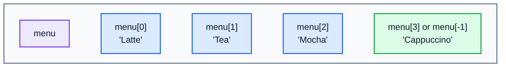
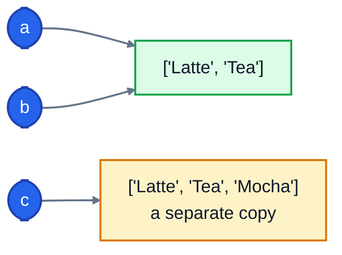

# 7. Lists and dictionaries

A variable holds one value. Real data comes in collections: the items on a menu, the orders taken today, the details of a customer. Python's two most useful collections are **lists**, for things in order, and **dictionaries**, for looking things up by name.

## Lists

A list holds several values in order, between square brackets:

```python
menu = ["Latte", "Tea", "Mocha", "Cappuccino"]
print(menu[0], menu[2], menu[-1])
print(len(menu))
print(menu[1:3], menu[:2], menu[2:])
```

```
Latte Mocha Cappuccino
4
['Tea', 'Mocha'] ['Latte', 'Tea'] ['Mocha', 'Cappuccino']
```

Each item has a position, called its **index**, and **counting starts at 0**:



- `menu[0]` is the first item. Negative indexes count from the end: `menu[-1]` is the last.
- `len(menu)` is the number of items, so the last index is always `len(menu) - 1`.
- A **slice** `menu[1:3]` gives a new list from index 1 up to, but not including, index 3. Leave out a number to go from the start (`menu[:2]`) or to the end (`menu[2:]`).

Ask for an index that doesn't exist and Python stops:

```
IndexError: list index out of range
```

### Changing a list

Lists can grow, shrink and change:

```python
menu = ["Latte", "Tea"]
menu.append("Mocha")
menu.insert(0, "Espresso")
print(menu)
menu.remove("Tea")
last = menu.pop()
print(menu, last)
menu[0] = "Double espresso"
print(menu)
print("Latte" in menu, "Tea" in menu)
```

```
['Espresso', 'Latte', 'Tea', 'Mocha']
['Espresso', 'Latte'] Mocha
['Double espresso', 'Latte']
True False
```

| Code | What it does |
|---|---|
| `items.append(x)` | add `x` to the end |
| `items.insert(i, x)` | add `x` at position `i` |
| `items.remove(x)` | remove the first `x` (an error if it isn't there) |
| `items.pop()` | remove the last item and give it back |
| `items[i] = x` | replace the item at position `i` |
| `x in items` | `True` if `x` is in the list |

### Working with numbers in a list

```python
prices = [3.40, 2.75, 2.10, 4.20]
print(sum(prices), min(prices), max(prices))
print(sorted(prices))
print(sorted(prices, reverse=True))
prices.sort()
print(prices)
```

```
12.45 2.1 4.2
[2.1, 2.75, 3.4, 4.2]
[4.2, 3.4, 2.75, 2.1]
[2.1, 2.75, 3.4, 4.2]
```

`sorted(prices)` gives you a **new** sorted list and leaves the original alone. `prices.sort()` sorts the list **in place** and gives back nothing. That difference causes a classic bug:

```python
prices = [3.40, 2.75]
prices = prices.sort()
print(prices)
```

```
None
```

`.sort()` returned `None`, and that `None` replaced the list. Use `prices.sort()` on its own line, or `prices = sorted(prices)`.

## Dictionaries

A dictionary stores **pairs**: a **key** and its **value**. You look things up by key, the way you look up a word in a real dictionary. Curly braces make one:

```python
prices = {"Latte": 3.40, "Tea": 2.10, "Mocha": 3.90}
print(prices["Tea"])
prices["Scone"] = 2.50
prices["Tea"] = 2.25
del prices["Mocha"]
print(prices)
print(len(prices), "Latte" in prices)
```

```
2.1
{'Latte': 3.4, 'Tea': 2.25, 'Scone': 2.5}
3 True
```

- `prices["Tea"]` looks up the value for the key `"Tea"`.
- Assigning to a key adds it if it's new, or replaces its value if it already exists.
- `del prices["Mocha"]` removes a key and its value.
- `in` checks whether a **key** exists.
- Keys are unique. You can't have two `"Tea"` entries.

Looking up a key that isn't there is an error:

```
KeyError: 'Juice'
```

`.get()` avoids it. It returns `None`, or a default you choose, when the key is missing:

```python
prices = {"Latte": 3.40, "Tea": 2.10}
print(prices.get("Juice"), prices.get("Juice", 0))
```

```
None 0
```

### Looping over a dictionary

`.items()` gives you each key and value together:

```python
prices = {"Latte": 3.40, "Tea": 2.10, "Scone": 2.50}
for item, price in prices.items():
    print(f"{item}: ${price:.2f}")
print(list(prices.keys()), list(prices.values()))
```

```
Latte: $3.40
Tea: $2.10
Scone: $2.50
['Latte', 'Tea', 'Scone'] [3.4, 2.1, 2.5]
```

Dictionaries keep their keys in the order you added them.

### Counting with a dictionary

A dictionary is the natural way to count things. This counts how many of each drink was ordered:

```python
orders = ["Latte", "Tea", "Latte", "Scone", "Latte", "Tea"]
counts = {}
for order in orders:
    counts[order] = counts.get(order, 0) + 1
print(counts)
```

```
{'Latte': 3, 'Tea': 2, 'Scone': 1}
```

`counts.get(order, 0)` is the count so far, or `0` the first time a drink appears. You'll use this pattern constantly.

## Lists of dictionaries

Real data usually mixes the two. A list of dictionaries is like a table: each dictionary is one row, and its keys are the columns. It's also exactly the shape of most data you get from websites and APIs.

```python
customers = [
    {"name": "Alex", "visits": 12, "member": True},
    {"name": "Sam", "visits": 3, "member": False},
]
for c in customers:
    print(c["name"], c["visits"])
print(customers[1]["name"])
```

```
Alex 12
Sam 3
Sam
```

`customers[1]["name"]` means "the second customer, then their name".

## List comprehensions

A **list comprehension** builds a new list from an existing one in a single line:

```python
prices = [3.40, 2.75, 2.10]
with_vat = [round(p * 1.2, 2) for p in prices]
cheap = [p for p in prices if p < 3]
print(with_vat, cheap)
```

```
[4.08, 3.3, 2.52] [2.75, 2.1]
```

Read `[round(p * 1.2, 2) for p in prices]` as "a list of `round(p * 1.2, 2)`, for each `p` in `prices`". The version with `if` keeps only the items that pass. Anything a comprehension does, a normal loop with `append` can do too, so use whichever you find clearer.

## Two names, one list

Remember from lesson 1 that a variable is a label on a value. With lists, that really matters:

```python
a = ["Latte"]
b = a
b.append("Tea")
print(a)
c = a.copy()
c.append("Mocha")
print(a, c)
```

```
['Latte', 'Tea']
['Latte', 'Tea'] ['Latte', 'Tea', 'Mocha']
```

`b = a` doesn't copy the list. It puts a second label on the **same** list, so changing it through `b` changes what `a` sees too. Use `.copy()` when you want a separate list.



This also means that a function you pass a list or dictionary to can change it. The exercise below relies on that: `add_item(cart, ...)` changes the `cart` you give it.

## Exercise: shopping cart

Open [exercise.py](./exercise.py). A shopping cart is stored as a dictionary. Each key is an item's name, and each value is another dictionary with its price and quantity:

```python
cart = {
    "Latte": {"price": 3.40, "quantity": 2},
    "Scone": {"price": 2.50, "quantity": 1},
}
```

Write these functions:

| Function | What it does |
|---|---|
| `add_item(cart, name, price, quantity=1)` | adds the item to the cart. If it's already there, increases its quantity instead. Returns nothing. |
| `remove_item(cart, name)` | removes the item. Returns `True` if it was there, `False` if it wasn't. |
| `cart_total(cart)` | the total cost (price times quantity for every item), rounded to 2 decimal places |
| `item_count(cart)` | how many items in total, counting quantities: 2 lattes and 1 scone is 3 |
| `most_expensive(cart)` | the name of the item with the highest **unit** price, or `None` for an empty cart |
| `receipt_lines(cart)` | a list of strings, one per item, **sorted by name**, like `"2 x Latte @ $3.40 = $6.80"` |

Run the tests from the lesson folder:

```bash
cd 07-lists-and-dictionaries
python3 -m unittest -v
```

<details>
<summary>Hint</summary>

Loop over the cart with `for name, details in cart.items():`, then use `details["price"]` and `details["quantity"]`. For `most_expensive`, keep track of the best name and price seen so far, the same way you'd find a maximum by hand. For `receipt_lines`, loop over `sorted(cart)`, which gives you the names in alphabetical order.

</details>

The full answer is in [solutions/07-lists-and-dictionaries.py](../solutions/07-lists-and-dictionaries.py).

## Recap

- A **list** keeps items in order. Index from 0; `items[-1]` is the last; slices like `items[1:3]` give a new list.
- `append`, `insert`, `remove` and `pop` change a list. `sorted()` returns a new list; `.sort()` changes it in place and returns `None`.
- A **dictionary** maps keys to values. Use `d.get(key, default)` when the key might be missing.
- Loop over a dictionary with `.items()`.
- `b = a` makes two names for the same list. Use `.copy()` for a separate one.

Next: [8. Files](../08-files/)
