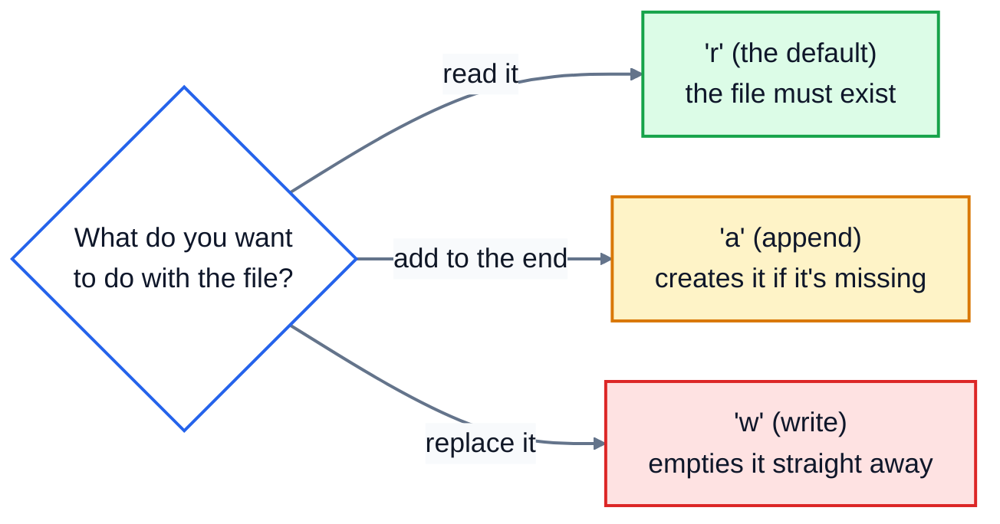

# 8. Files

Everything your programs have done so far disappears when they stop. To keep data between runs, or to work with data from somewhere else, like a bank export, a spreadsheet or a list of customers, you read and write **files**.

## Reading a text file

Say the café keeps a to-do list in a file called `todo.txt`:

```
Buy milk
Call the supplier
Fix the till printer
```

Read the whole thing at once:

```python
with open("todo.txt") as f:
    text = f.read()
print(text)
```

```
Buy milk
Call the supplier
Fix the till printer
```

`open()` opens the file and gives you a **file object**, here called `f`. `with` makes sure the file is closed again when the indented block ends, even if something goes wrong inside it. Always open files with `with`.

### One line at a time

Looping over a file gives you one line per pass. Each line still ends with its newline character, `\n`:

```python
with open("todo.txt") as f:
    for line in f:
        print(repr(line))
```

```
'Buy milk\n'
'Call the supplier\n'
'Fix the till printer\n'
```

(`repr()` shows the value exactly, including invisible characters like `\n`.) That newline catches people out: `line == "Buy milk"` is `False`, because the line is really `"Buy milk\n"`. Remove it with `.strip()`:

```python
with open("todo.txt") as f:
    for line in f:
        print("-", line.strip())
```

```
- Buy milk
- Call the supplier
- Fix the till printer
```

To get all the lines as a list, without the newlines:

```python
with open("todo.txt") as f:
    tasks = f.read().splitlines()
print(tasks)
```

```
['Buy milk', 'Call the supplier', 'Fix the till printer']
```

## Writing a file

The second argument to `open()` is the **mode**. `"r"` (read) is the default. To write, use `"w"` or `"a"`:

```python
with open("shopping.txt", "w") as f:
    f.write("Coffee beans\n")
    f.write("Oat milk\n")
with open("shopping.txt", "a") as f:
    f.write("Paper cups\n")
with open("shopping.txt") as f:
    print(f.read())
```

```
Coffee beans
Oat milk
Paper cups
```

Choose the mode carefully. One of them deletes what's already there:



- `"w"` creates the file if it doesn't exist, and **empties it immediately if it does**, before you've written anything.
- `"a"` adds to the end and keeps what's there.
- `write()` doesn't add a newline for you. Put `\n` at the end of each line yourself.

### Text encoding

Files are stored as bytes, and an **encoding** says how bytes become characters. Different computers default to different encodings, which can garble characters like `é` or `€`. Say `encoding="utf-8"` whenever you open a text file, and your program behaves the same everywhere:

```python
with open("menu.txt", "w", encoding="utf-8") as f:
    f.write("Café crème: €3.50\n")
```

## When the file isn't there

```
FileNotFoundError: [Errno 2] No such file or directory: 'missing.txt'
```

A file name on its own, like `"todo.txt"`, is looked for in the **current working directory**: the folder your terminal was in when you ran the program. That's not necessarily the folder the `.py` file is in. If Python can't find a file you can see, check where you ran the program from, and check the spelling.

## Paths

Python's `pathlib` module handles file paths, and works the same on Windows, macOS and Linux:

```python
from pathlib import Path
p = Path("reports") / "march.txt"
print(p, p.name, p.suffix, p.exists())
print(Path("todo.txt").exists())
```

```
reports/march.txt march.txt .txt False
True
```

`/` joins parts of a path, so you never have to worry about whether the separator is `/` or `\`. `.exists()` checks whether a file is there before you try to open it.

## CSV files

**CSV** (comma-separated values) is the simplest format for tables. Every spreadsheet program can open and save it, and banks, shops and websites export data this way. Here's `staff.csv`:

```
name,role,hourly_rate
Alex Kim,barista,15.50
Sam Rivera,manager,21.00
Priya Shah,barista,15.50
```

You could split each line on commas yourself, but that breaks as soon as a value contains a comma, like `"Smith, John"`. Python's `csv` module handles all of that for you. `csv.DictReader` gives each row as a dictionary, using the first line as the keys:

```python
import csv
with open("staff.csv", newline="") as f:
    for row in csv.DictReader(f):
        print(row["name"], float(row["hourly_rate"]) * 8)
```

```
Alex Kim 124.0
Sam Rivera 168.0
Priya Shah 124.0
```

Notice the `float()`. Everything read from a CSV file is text. Collect the rows with `rows = list(csv.DictReader(f))` and look at the first one:

```
{'name': 'Alex Kim', 'role': 'barista', 'hourly_rate': '15.50'}
```

To write a CSV file, use `csv.writer` and give it one list per row:

```python
import csv
with open("hours.csv", "w", newline="") as f:
    writer = csv.writer(f)
    writer.writerow(["name", "hours"])
    writer.writerow(["Alex Kim", 32])
    writer.writerow(["Sam Rivera", 40])
```

```
name,hours
Alex Kim,32
Sam Rivera,40
```

Open CSV files with `newline=""`, as in these examples. The `csv` module handles line endings itself, and without it you can get blank lines between rows on Windows.

## JSON files

**JSON** stores structured data, the same dictionaries and lists you already know. It's the standard format for settings files and for data sent between programs on the web. The `json` module saves and loads it:

```python
import json
settings = {"shop": "Corner Café", "open": "07:00", "tables": 12, "wifi": True}
with open("settings.json", "w") as f:
    json.dump(settings, f, indent=2)
with open("settings.json") as f:
    loaded = json.load(f)
print(loaded["tables"] + 1)
```

`settings.json` now contains:

```json
{
  "shop": "Corner Café",
  "open": "07:00",
  "tables": 12,
  "wifi": true
}
```

```
13
```

Unlike CSV, JSON keeps types: `12` comes back as a number and `true` as `True`. `indent=2` makes the file readable for people.

By default, `json` writes characters like `é` as codes such as `é`. It still loads back correctly, but if people will read the file, add `ensure_ascii=False`, and open the file with `encoding="utf-8"`.

## Exercise: spending report

The lesson folder has [transactions.csv](./transactions.csv), a bank export of a month's spending:

```
date,description,category,amount
2026-03-01,Corner Café,eating out,4.80
2026-03-02,City Supermarket,groceries,62.35
...
```

Open [exercise.py](./exercise.py) and write these functions:

| Function | What it does |
|---|---|
| `load_transactions(path)` | reads the CSV file and returns a list of dictionaries, one per row, with `amount` converted to a `float` |
| `total_by_category(transactions)` | returns a dictionary of category to total amount, each rounded to 2 decimal places |
| `write_summary(totals, path)` | writes a CSV file with the header `category,total`, then one row per category, **biggest total first**, with totals shown to 2 decimal places (`62.35`, `5.00`) |
| `save_json(data, path)` | saves any dictionary or list to a JSON file, with `indent=2` |
| `load_json(path)` | loads a JSON file and returns what's in it |

Run the tests from the lesson folder:

```bash
cd 08-files
python3 -m unittest -v
```

The tests write their files into a temporary folder, so they never touch your own files. When you run `python3 exercise.py` directly, it writes `output/summary.csv` and `output/totals.json` in the lesson folder. Have a look at them.

<details>
<summary>Hint</summary>

For loading, use `csv.DictReader`, and change each row's `"amount"` with `row["amount"] = float(row["amount"])` before you add the row to your list. For the summary, sort the categories by their totals: `sorted(totals, key=totals.get, reverse=True)` gives the category names, biggest total first. Write each total with `f"{total:.2f}"`.

</details>

The full answer is in [solutions/08-files.py](../solutions/08-files.py).

## Recap

- Open files with `with open(path, mode, encoding="utf-8") as f:`, so they're always closed.
- `"r"` reads, `"a"` appends, and `"w"` **replaces** the whole file.
- Lines you read end with `\n`. Use `.strip()` or `.splitlines()`.
- File names are found relative to the folder you ran the program from.
- Use the `csv` module for spreadsheet-style data (everything comes back as text), and the `json` module for structured data (types are kept).

Next: [9. Errors and exceptions](../09-errors-and-exceptions/)
