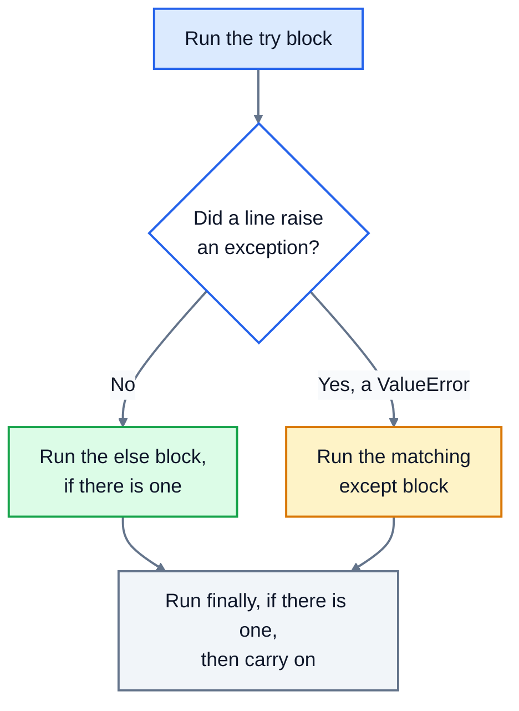

# 9. Errors and exceptions

Things go wrong in every real program. A user types "three" where you expected a number. A file has been deleted. A website is down. When Python hits a problem it can't handle, it raises an **exception** and stops. This lesson is about reading those errors, and handling the ones you expect so your program keeps working.

## Reading a traceback

Here's a small program that crashes, saved as `shop.py`:

```python
def average(prices):
    return sum(prices) / len(prices)

def report(prices):
    print("Average price:", average(prices))

report([])
```

```
Traceback (most recent call last):
  File "shop.py", line 7, in <module>
    report([])
  File "shop.py", line 5, in report
    print("Average price:", average(prices))
  File "shop.py", line 2, in average
    return sum(prices) / len(prices)
ZeroDivisionError: division by zero
```

Read a traceback **from the bottom up**:

1. **The last line** says what went wrong: the type of error (`ZeroDivisionError`) and a message (`division by zero`).
2. **The line above it** shows exactly where: line 2, inside `average`.
3. **The lines further up** show how the program got there: line 7 called `report`, which called `average`. That's useful when the bug is really in the code that passed the wrong value, here the empty list.

Recent versions of Python also mark the exact part of the line with `^` or `~` characters. They look slightly different from version to version.

## Errors you'll meet often

| Error | Usually means | Example |
|---|---|---|
| `SyntaxError` | the code isn't valid Python: a missing colon, bracket or quote | `if x > 3` |
| `IndentationError` | the indentation is wrong | a missing indent after `if` |
| `NameError` | a name that doesn't exist, often a typo | `print(totl)` |
| `TypeError` | the wrong type for the operation | `"5" + 5` |
| `ValueError` | the right type but an unusable value | `int("three")` |
| `ZeroDivisionError` | dividing by zero | `10 / 0` |
| `IndexError` | a list position that doesn't exist | `items[10]` on a short list |
| `KeyError` | a dictionary key that doesn't exist | `prices["Juice"]` |
| `AttributeError` | the value doesn't have that method, often because it's `None` | `None.upper()` |
| `FileNotFoundError` | no file at that path | `open("missing.txt")` |

The `AttributeError: 'NoneType' object has no attribute ...` one deserves a mention, because it's so common. It means a variable you expected to hold something holds `None`, usually because a function didn't `return` anything.

## Handling an exception: try and except

When you know something might fail, wrap it in `try`, and say what to do instead in `except`:

```python
try:
    people = int("three")
    print("This line is skipped")
except ValueError:
    print("That's not a whole number")
print("The program carries on")
```

```
That's not a whole number
The program carries on
```

Python runs the `try` block. As soon as a line raises a `ValueError`, it jumps to the matching `except` block and skips the rest of `try`. Afterwards, the program carries on as normal. If nothing goes wrong, the `except` block is skipped entirely.



### Asking again until the input is valid

This is where `try` really earns its place. Combine it with a `while` loop to keep asking until the user gives a usable answer. You can have several `except` blocks for different errors:

```python
while True:
    try:
        people = int(input("How many people? "))
        each = 100 / people
        break
    except ValueError:
        print("Please type a whole number, like 4")
    except ZeroDivisionError:
        print("There must be at least one person")
print(f"Each person pays ${each:.2f}")
```

```
How many people? abc
Please type a whole number, like 4
How many people? 0
There must be at least one person
How many people? 4
Each person pays $25.00
```

`break` only runs if both lines before it succeeded, so the loop ends only on a valid answer.

### Getting the error message

`except ... as error` gives you the exception itself, so you can show or record its message:

```python
try:
    int("12.5")
except ValueError as error:
    print("Problem:", error)
```

```
Problem: invalid literal for int() with base 10: '12.5'
```

## else and finally

Two optional extra blocks:

- `else` runs only if the `try` block **didn't** raise an exception.
- `finally` runs **no matter what**, error or not. It's used for clean-up, like closing a connection.

```python
def read_menu(path):
    try:
        f = open(path, encoding="utf-8")
    except FileNotFoundError:
        print("No menu file yet, starting with an empty menu")
        return []
    else:
        with f:
            return f.read().splitlines()
    finally:
        print("Finished looking for", path)

print(read_menu("menu.txt"))
```

```
No menu file yet, starting with an empty menu
Finished looking for menu.txt
[]
```

Notice that `finally` ran even though the `except` block had already said `return`.

## Raising your own exceptions

Your own functions can raise exceptions too, when they're given something they can't sensibly handle:

```python
def set_quantity(quantity):
    if quantity < 1:
        raise ValueError(f"Quantity must be at least 1, got {quantity}")
    return quantity

set_quantity(0)
```

```
ValueError: Quantity must be at least 1, got 0
```

This is better than quietly returning a strange value. The problem is reported straight away, with a message that explains it, and whoever called the function can catch it with `try` if they want to. Use `ValueError` for a bad value and `TypeError` for the wrong type.

## Catch only what you expect

It's tempting to wrap everything in a bare `except:`, but that hides real bugs:

```python
try:
    total = undefined_name + 1
except:
    print("Something went wrong")
```

```
Something went wrong
```

That was a typo, a `NameError`, but the program reported it as a vague "something went wrong" and carried on with no `total`. Always name the exception you expect, as in `except ValueError:`, and keep the `try` block small, around just the line that can fail. Errors you didn't expect should crash with a full traceback, because that's how you find and fix them.

## Exercise: careful input handling

Open [exercise.py](./exercise.py) and write these functions:

| Function | What it does |
|---|---|
| `parse_amount(text)` | turns text like `"12.50"`, `" $1,234.99 "` or `"$5"` into a float. It strips spaces, then removes one leading `$` and any commas. If what's left isn't a number, it raises `ValueError` with the message `Not a valid amount: '<the original text>'`. If the amount is zero or negative, it raises `ValueError` with the message `Amount must be more than zero`. |
| `safe_divide(a, b)` | returns `a / b`, or `None` if `b` is zero. Use `try`/`except`, not an `if`. |
| `read_setting(path, key, default)` | reads a JSON file and returns `data[key]`. If the file doesn't exist, isn't valid JSON, or doesn't have that key, it returns `default` instead of crashing. |
| `ask_for_quantity()` | asks `Quantity: ` until the user types a whole number of at least 1, then returns it. After invalid input it prints `Please enter a whole number of at least 1` and asks again. |

Run the tests from the lesson folder:

```bash
cd 09-errors-and-exceptions
python3 -m unittest -v
```

The tests for `ask_for_quantity` replace `input()` with a fake that "types" answers for you, using `unittest.mock`. You don't need to do anything special: just use `input()` as normal.

<details>
<summary>Hint</summary>

In `parse_amount`, put only the `float(...)` call inside `try`. In its `except ValueError:` block, `raise ValueError(f"Not a valid amount: {text!r}")`. (`!r` puts quotes around the text.) Check for zero or less after the conversion. For `read_setting`, one `except` can catch several errors at once: `except (FileNotFoundError, json.JSONDecodeError, KeyError):`.

</details>

The full answer is in [solutions/09-errors-and-exceptions.py](../solutions/09-errors-and-exceptions.py).

## Recap

- Read a traceback from the bottom: the error type and message, then where it happened.
- `try`/`except SomeError:` handles an error you expect. The program carries on.
- `else` runs when there was no error; `finally` always runs.
- `raise ValueError("message")` reports a problem in your own functions.
- Catch specific exceptions, around as little code as possible. Never use a bare `except:`.

Next: [10. Project: expense tracker](../10-project-expense-tracker/)
