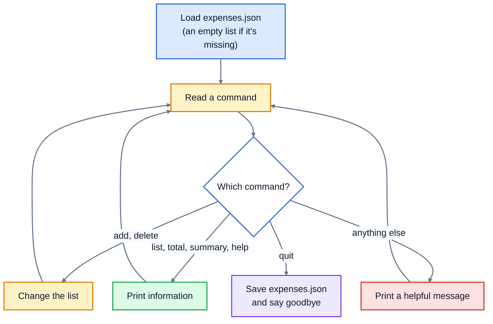

# 10. Project: expense tracker

Time to put everything together. You'll build a real program that people actually use: a command-line expense tracker. You type commands, it records what you spend, and it remembers everything between runs by saving to a file.

Here's what a session looks like when it's finished. Lines starting with `>` are what the user typed:

```
Expense tracker. Type help to see the commands.
> add 12.50 food Lunch with Sam
Added: $12.50 food (Lunch with Sam)
> add 2.00 transport Bus to work
Added: $2.00 transport (Bus to work)
> add 4.80 food Coffee
Added: $4.80 food (Coffee)
> list
1. $12.50 food: Lunch with Sam
2. $2.00 transport: Bus to work
3. $4.80 food: Coffee
> total
Total: $19.30
> summary
food: $17.30
transport: $2.00
> delete 2
Deleted: Bus to work
> add lots food Dinner
Not a valid amount: 'lots'
> quit
Saved 2 expenses. Goodbye.
```

Run it again later, and `list` still shows the two expenses.

## How the program fits together



The expenses live in memory as a **list of dictionaries**, one per expense:

```python
expenses = [
    {"amount": 12.5, "category": "food", "description": "Lunch with Sam"},
    {"amount": 2.0, "category": "transport", "description": "Bus to work"},
]
```

That's exactly the shape JSON can store, so saving and loading is one line each.

The work is split into small functions that each do one job and **return** a result, and a `main()` function that runs the command loop and does all the printing. That split is what makes the program easy to test, and it's how real programs are organised.

## The commands

| Command | Example | What it prints |
|---|---|---|
| `add <amount> <category> <description>` | `add 12.50 food Lunch with Sam` | `Added: $12.50 food (Lunch with Sam)` |
| `list` | `list` | one numbered line per expense, like `1. $12.50 food: Lunch with Sam`, or `No expenses yet` |
| `total` | `total` | `Total: $19.30` |
| `summary` | `summary` | one line per category, biggest first, like `food: $17.30` |
| `delete <number>` | `delete 2` | `Deleted: Bus to work`, or `No expense number 9` |
| `help` | `help` | a list of the commands |
| `quit` | `quit` | `Saved 2 expenses. Goodbye.` |

Anything else prints `Unknown command. Type help to see the commands.` Commands are case-insensitive, and the description can contain spaces. A bad amount prints the error message from `parse_amount` (from lesson 9), and the program carries on.

## Build it in steps

Open [exercise.py](./exercise.py). It has every function you need, empty, with a docstring saying what it should do. Don't try to write it all at once. Build it in this order, and run the tests after each step. The test names tell you which step they belong to.

### Step 1: amounts and expenses

- `parse_amount(text)`: the same as in lesson 9. Copy your version in.
- `make_expense(amount_text, category, description)`: returns a dictionary with the keys `amount` (a float, from `parse_amount`), `category` (lowercase, with spaces stripped) and `description` (with spaces stripped).

### Step 2: reporting

- `total(expenses)`: the sum of all the amounts, rounded to 2 decimal places.
- `summary(expenses)`: a dictionary of category to total, rounded to 2 decimal places.
- `format_expense(number, expense)`: one line of text, like `1. $12.50 food: Lunch with Sam`.

### Step 3: deleting

- `delete_expense(expenses, number_text)`: removes the expense with that number. Numbers start at **1**, as people count, not at 0 as Python does. Returns the removed expense, or `None` if the number isn't valid. That includes text that isn't a number at all, like `delete two`.

### Step 4: saving and loading

- `load_expenses(path)`: returns the list saved in the JSON file, or an empty list if the file doesn't exist yet.
- `save_expenses(expenses, path)`: saves the list as JSON, with `indent=2`.

### Step 5: the command loop

- `main(path="expenses.json")`: loads the expenses, prints the welcome line, then keeps reading commands with the prompt `> ` until `quit`. Use the functions from steps 1 to 4 for the real work. Saving happens on `quit`.

Splitting a command line is the trickiest bit. `line.split(maxsplit=3)` splits on spaces at most three times, so the description stays together:

```python
>>> "add 12.50 food Lunch with Sam".split(maxsplit=3)
['add', '12.50', 'food', 'Lunch with Sam']
```

Check how many parts you got before using them: `add 12.50` on its own should print `Usage: add <amount> <category> <description>` rather than crash with an `IndexError`.

## Running the tests and the program

```bash
cd 10-project-expense-tracker
python3 -m unittest -v
```

The tests check each function, and then run your whole program the way a user would, typing commands into it in a temporary folder.

To use it yourself:

```bash
python3 exercise.py
```

It creates `expenses.json` in the folder you run it from. Open that file after a session and you'll see your data, in exactly the format of the list above.

<details>
<summary>Hints</summary>

- For the command loop, use `while True:`, read a line with `input("> ").strip()`, skip empty lines with `continue`, and `break` after handling `quit`.
- Take the command from `parts[0].lower()`, and use `if`/`elif` to decide what to do.
- `add` needs exactly 4 parts. Wrap the call to `make_expense` in `try`/`except ValueError as error:` and print the error.
- In `delete_expense`, turn the text into a whole number with `int()` inside `try`. Then check it's between 1 and `len(expenses)`, and use `expenses.pop(number - 1)`.
- For `summary`, print the categories biggest first with `sorted(totals, key=totals.get, reverse=True)`.

</details>

The full answer is in [solutions/10-project-expense-tracker.py](../solutions/10-project-expense-tracker.py).

## Ideas to take it further

Once the tests pass, the program is yours. Some ideas, roughly from easiest to hardest:

- Add a date to every expense, with `datetime.date.today().isoformat()`, and show it in `list`.
- Add a `budget <category> <amount>` command, and warn when a category goes over its budget.
- Export to CSV with a new `export` command, so you can open your expenses in a spreadsheet.
- Save after every change instead of only on `quit`, so nothing is lost if the program crashes.

## What you've learned

This project used every lesson in the course: variables and types for the data, input and output for the conversation with the user, conditionals to pick a command, a loop to keep it running, functions to organise it, a list of dictionaries to hold the expenses, a JSON file to remember them, and exceptions to survive bad input. That's the core of almost every program you'll write from here on.
